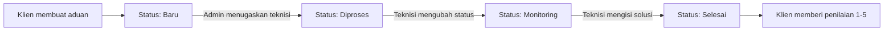
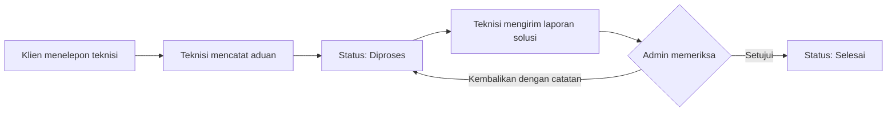
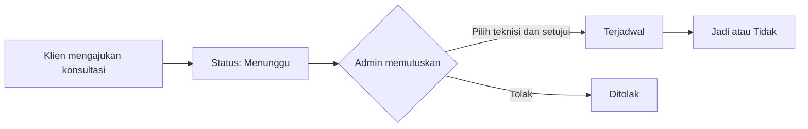

# Analisis Kebutuhan Sistem (Modul 1)

Dokumen ini merangkum kebutuhan fungsional dan non-fungsional, alur sistem, dan ERD awal Disty HelpDesk. Isinya disusun dari kode yang sudah berjalan (endpoint, aturan validasi, skema database) sehingga cocok dengan sistem yang dibangun.

## 1. Gambaran sistem

Disty HelpDesk adalah layanan bantuan teknis PT Disty Teknologi Indonesia (Surabaya) untuk klien berupa instansi, misalnya SMK Negeri 2 Surabaya, SMA Negeri 5 Surabaya, dan MAN 1 Sidoarjo pada data contoh. Klien melaporkan kendala atau meminta pengembangan fitur, menjadwalkan konsultasi, dan memantau penanganan sampai selesai.

Tujuan:
1. Aduan klien tercatat dan diteruskan ke teknisi yang tepat.
2. Penanganan mengikuti urutan status yang jelas dan riwayat tindakannya tersimpan.
3. Konsultasi dijadwalkan dengan kuota per jam.
4. Kepuasan klien terukur lewat penilaian dan survei.

## 2. Aktor

| Aktor | Peran dalam sistem |
|---|---|
| Klien | Perwakilan instansi (email berdomain instansi terdaftar). Membuat aduan dan konsultasi, memberi penilaian dan survei |
| Teknisi | Menangani aduan: mencatat progres, mengubah status, mengisi solusi dan foto dokumentasi, mencatat aduan telepon |
| Admin | Mengatur prioritas, menugaskan teknisi, memverifikasi aduan telepon, mengelola teknisi, konsultasi, dan kuota |

## 3. Kebutuhan fungsional

| Kode | Aktor | Kebutuhan |
|---|---|---|
| F-01 | Semua | Masuk dengan email dan kata sandi, keluar, melihat profil |
| F-02 | Semua | Mengubah profil (nama, email, telepon, foto) dan kata sandi |
| F-03 | Semua | Mengunggah foto (JPG, PNG, WEBP, GIF) |
| F-04 | Semua | Melihat daftar panduan (knowledge base) per kategori |
| F-05 | Klien | Membuat aduan: jenis (Gangguan / Error atau Pengembangan / Update Fitur), bagian bermasalah, deskripsi, lampiran |
| F-06 | Klien | Melihat daftar dan detail aduan instansinya |
| F-07 | Klien | Memberi penilaian 1 sampai 5 setelah aduan Selesai |
| F-08 | Klien | Mengajukan konsultasi (topik, catatan, tanggal, jam) |
| F-09 | Klien | Mengisi survei kepuasan (satu per akun, bisa diperbarui) |
| F-10 | Admin | Menentukan prioritas aduan (Urgent, Tinggi, Sedang, Rendah) |
| F-11 | Admin | Menugaskan teknisi ke aduan |
| F-12 | Admin | Memverifikasi aduan telepon (setujui atau kembalikan ke teknisi) |
| F-13 | Admin | Menambah, mengubah spesialisasi, dan menghapus teknisi |
| F-14 | Admin | Mengelola konsultasi: status, teknisi, jadwal ulang dengan alasan, pesan |
| F-15 | Admin | Mengatur kuota konsultasi per jam |
| F-16 | Teknisi | Mencatat log progres pada aduan |
| F-17 | Teknisi | Mengubah status aduan satu tahap ke depan (Baru, Diproses, Monitoring, Selesai) |
| F-18 | Teknisi | Mengisi solusi (bagian, ringkasan, penanggung jawab) yang sekaligus menyelesaikan aduan |
| F-19 | Teknisi | Mengunggah foto dokumentasi sebelum dan sesudah perbaikan |
| F-20 | Teknisi | Mencatat aduan yang masuk lewat telepon |

Dashboard dan laporan bulanan Admin ditampilkan oleh front-end dari data aduan yang diambil lewat API.

## 4. Aturan bisnis

- Urutan status aduan wajib Baru, Diproses, Monitoring, Selesai. Melompat atau mundur ditolak dengan 409.
- Penugasan teknisi pertama mengubah status Baru menjadi Diproses.
- Solusi hanya bisa diisi dari status Monitoring.
- Aduan telepon dicatat teknisi (teknisi pencatat menjadi teknisi utama) dan butuh verifikasi Admin sebelum Selesai.
- Konsultasi hanya pada jam 09.00, 10.00, 11.00, 13.00, 14.00, dan 15.00. Jam yang penuh ditolak dengan 409 `KUOTA_PENUH`.
- Klien hanya melihat aduan dan konsultasi instansinya. Email klien harus berdomain instansi terdaftar.
- Penilaian aduan 1 sampai 5 dan hanya setelah Selesai.
- Target waktu penanganan (SLA) per prioritas yang dipakai front-end: Urgent 4 jam, Tinggi 8 jam, Sedang 24 jam, Rendah 72 jam.

## 5. Kebutuhan non-fungsional

| Aspek | Kebutuhan |
|---|---|
| Keamanan | Autentikasi JWT, masa berlaku bawaan 8 jam. Kata sandi disimpan sebagai hash. Akses dibatasi per peran dan per instansi |
| Validasi kata sandi | 8 sampai 72 karakter, mengandung huruf dan angka |
| Unggahan | Maksimal 5 MB, jenis berkas diperiksa dari isinya, nama berkas acak 32 karakter heksadesimal. Foto hanya diterima dari alamat hasil `/uploads` |
| Konsistensi API | Semua respons berformat `{ data }` atau `{ error: { code, message, details } }` |
| Portabilitas | Dua back-end (Laravel dan Node.js) dengan kontrak API dan database yang sama |
| Penyebaran | Dapat dipasang di VPS Ubuntu atau Docker (folder `deploy/`, `Dockerfile`, `docker-compose.yml`) |
| Kemudahan uji | Tes otomatis Laravel dan Node.js (lihat `docs/PENGUJIAN.md`) |

## 6. Alur sistem

### 6.1 Siklus aduan

### 6.2 Aduan lewat telepon

### 6.3 Konsultasi

## 7. ERD awal

ERD dari analis ada di `database/ERD_DISTY_1.drawio` (13 tabel). Diagram relasi dan daftar kolom ada di `docs/DATABASE.md`.

| Kelompok | Tabel |
|---|---|
| Pengguna | `instansi`, `pengguna` |
| Aduan | `modul`, `aduan`, `penugasan_teknisi`, `riwayat_aduan`, `solusi_aduan`, `artikel_bantuan`, `survei` |
| Konsultasi | `konsultasi`, `pesan_konsultasi`, `riwayat_konsultasi`, `kuota_konsultasi` |
