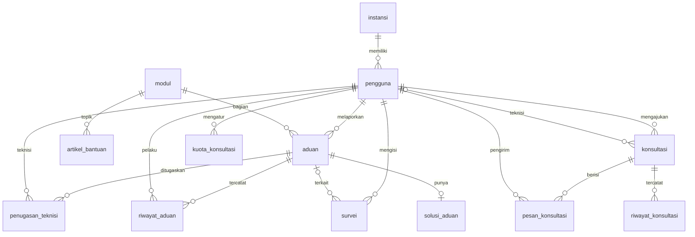

# Dokumentasi Database (Modul 4 dan 11)

Database MySQL `disty_helpdesk`, 13 tabel, dibangun oleh `database/migrations/2026_11_01_000001_buat_skema_erd.php` dan dimuat ulang oleh `database/disty_helpdesk.sql`. File ERD asli: `database/ERD_DISTY_1.drawio`.

## Diagram relasi

## Relasi (kunci asing)

| Tabel.kolom | Mengacu ke | Saat induk dihapus |
|---|---|---|
| `pengguna.instansi_id` | `instansi.id` | ditolak |
| `aduan.pelapor_id` | `pengguna.id` | ditolak |
| `aduan.modul_id` | `modul.id` | ditolak |
| `penugasan_teknisi.aduan_id` | `aduan.id` | ikut terhapus |
| `penugasan_teknisi.teknisi_id` | `pengguna.id` | ditolak |
| `riwayat_aduan.aduan_id` | `aduan.id` | ikut terhapus |
| `riwayat_aduan.pengguna_id` | `pengguna.id` | ditolak |
| `solusi_aduan.aduan_id (unik)` | `aduan.id` | ikut terhapus |
| `artikel_bantuan.modul_id` | `modul.id` | ditolak |
| `survei.pengguna_id` | `pengguna.id` | ikut terhapus |
| `survei.aduan_id` | `aduan.id` | diisi NULL |
| `konsultasi.pengaju_id` | `pengguna.id` | ditolak |
| `konsultasi.teknisi_id` | `pengguna.id` | diisi NULL |
| `pesan_konsultasi.konsultasi_id` | `konsultasi.id` | ikut terhapus |
| `pesan_konsultasi.pengirim_id` | `pengguna.id` | ditolak |
| `riwayat_konsultasi.konsultasi_id` | `konsultasi.id` | ikut terhapus |
| `kuota_konsultasi.diatur_oleh` | `pengguna.id` | ditolak |

Kunci unik penting: `instansi.kode_instansi`, `instansi.domain_email`, `pengguna.email`, `modul.nama_modul`, `aduan.kode_aduan` (contoh `HD-014`), pasangan `penugasan_teknisi(aduan_id, teknisi_id)`.

## Daftar tabel dan kolom

### `instansi`

| Kolom | Tipe |
|---|---|
| `id` | `BIGINT` |
| `kode_instansi` | `VARCHAR(20)` |
| `nama_instansi` | `VARCHAR(100)` |
| `domain_email` | `VARCHAR(100)` |
| `created_at` | `TIMESTAMP` |
| `updated_at` | `TIMESTAMP` |

### `pengguna`

| Kolom | Tipe |
|---|---|
| `id` | `BIGINT` |
| `nama` | `VARCHAR(100)` |
| `email` | `VARCHAR(255)` |
| `password` | `VARCHAR(255)` |
| `telepon` | `VARCHAR(20)` |
| `role` | `ENUM('klien','admin','teknisi')` |
| `spesialisasi` | `VARCHAR(50)` |
| `instansi_id` | `BIGINT` |
| `status` | `ENUM('aktif','nonaktif')` |
| `kode_aktivasi` | `VARCHAR(8)` |
| `foto` | `VARCHAR(255)` |
| `last_login` | `DATETIME` |
| `created_at` | `TIMESTAMP` |
| `updated_at` | `TIMESTAMP` |

### `modul`

| Kolom | Tipe |
|---|---|
| `id` | `BIGINT` |
| `nama_modul` | `VARCHAR(50)` |
| `created_at` | `TIMESTAMP` |
| `updated_at` | `TIMESTAMP` |

### `aduan`

| Kolom | Tipe |
|---|---|
| `id` | `BIGINT` |
| `kode_aduan` | `VARCHAR(10)` |
| `pelapor_id` | `BIGINT` |
| `modul_id` | `BIGINT` |
| `kategori` | `VARCHAR(30)` |
| `judul` | `VARCHAR(100)` |
| `deskripsi` | `TEXT` |
| `prioritas` | `ENUM('Urgent','Tinggi','Sedang','Rendah')` |
| `status` | `ENUM('Baru','Diproses','Monitoring','Selesai')` |
| `kanal` | `ENUM('web','telepon')` |
| `menunggu_verifikasi` | `TINYINT(1)` |
| `lampiran` | `VARCHAR(255)` |
| `foto_sebelum` | `VARCHAR(255)` |
| `foto_sesudah` | `VARCHAR(255)` |
| `rating` | `TINYINT` |
| `created_at` | `TIMESTAMP` |
| `updated_at` | `TIMESTAMP` |

### `penugasan_teknisi`

| Kolom | Tipe |
|---|---|
| `id` | `BIGINT` |
| `aduan_id` | `BIGINT` |
| `teknisi_id` | `BIGINT` |
| `peran` | `ENUM('utama','pendamping')` |
| `created_at` | `TIMESTAMP` |
| `updated_at` | `TIMESTAMP` |

### `riwayat_aduan`

| Kolom | Tipe |
|---|---|
| `id` | `BIGINT` |
| `aduan_id` | `BIGINT` |
| `pengguna_id` | `BIGINT` |
| `tindakan` | `TEXT` |
| `created_at` | `TIMESTAMP` |
| `updated_at` | `TIMESTAMP` |

### `solusi_aduan`

| Kolom | Tipe |
|---|---|
| `--` | `Aduan` |
| `id` | `BIGINT` |
| `aduan_id` | `BIGINT` |
| `masalah` | `VARCHAR(150)` |
| `solusi` | `TEXT` |
| `tanggal_selesai` | `DATETIME` |
| `created_at` | `TIMESTAMP` |
| `updated_at` | `TIMESTAMP` |

### `artikel_bantuan`

| Kolom | Tipe |
|---|---|
| `id` | `BIGINT` |
| `modul_id` | `BIGINT` |
| `judul` | `VARCHAR(150)` |
| `isi` | `TEXT` |
| `created_at` | `TIMESTAMP` |
| `updated_at` | `TIMESTAMP` |

### `survei`

| Kolom | Tipe |
|---|---|
| `id` | `BIGINT` |
| `pengguna_id` | `BIGINT` |
| `aduan_id` | `BIGINT` |
| `nilai_keseluruhan` | `TINYINT` |
| `nilai_respon` | `TINYINT` |
| `nilai_kemudahan` | `TINYINT` |
| `nilai_kualitas` | `TINYINT` |
| `terselesaikan` | `ENUM('Ya','Sebagian','Belum')` |
| `komentar` | `TEXT` |
| `created_at` | `TIMESTAMP` |
| `updated_at` | `TIMESTAMP` |
| `AND` | `nilai_kemudahan` |

### `konsultasi`

| Kolom | Tipe |
|---|---|
| `id` | `BIGINT` |
| `pengaju_id` | `BIGINT` |
| `teknisi_id` | `BIGINT` |
| `topik` | `VARCHAR(150)` |
| `catatan` | `TEXT` |
| `tanggal` | `DATE` |
| `jam` | `VARCHAR(5)` |
| `status` | `ENUM('Menunggu','Terjadwal','Jadi','Tidak','Ditolak')` |
| `jumlah_ubah_jadwal` | `TINYINT` |
| `created_at` | `TIMESTAMP` |
| `updated_at` | `TIMESTAMP` |

### `pesan_konsultasi`

| Kolom | Tipe |
|---|---|
| `id` | `BIGINT` |
| `konsultasi_id` | `BIGINT` |
| `pengirim_id` | `BIGINT` |
| `pesan` | `TEXT` |
| `created_at` | `TIMESTAMP` |
| `updated_at` | `TIMESTAMP` |

### `riwayat_konsultasi`

| Kolom | Tipe |
|---|---|
| `id` | `BIGINT` |
| `konsultasi_id` | `BIGINT` |
| `aktivitas` | `VARCHAR(255)` |
| `created_at` | `TIMESTAMP` |
| `updated_at` | `TIMESTAMP` |

### `kuota_konsultasi`

| Kolom | Tipe |
|---|---|
| `id` | `BIGINT` |
| `diatur_oleh` | `BIGINT` |
| `tanggal` | `DATE` |
| `jam` | `VARCHAR(5)` |
| `kuota` | `TINYINT` |
| `created_at` | `TIMESTAMP` |
| `updated_at` | `TIMESTAMP` |

## Data contoh

`database/data/demo.json` (sama dengan isi SQL): 24 akun (1 admin, 3 teknisi, 20 klien), 20 instansi, 12 aduan, 5 konsultasi, 6 survei, 11 artikel bantuan. Semua kata sandi demo adalah `rahasia123` dan hanya untuk pengembangan.
